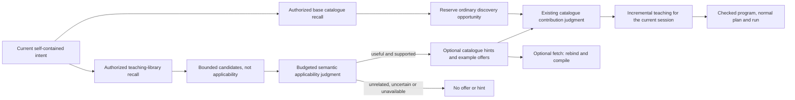

# Teaching-library recall and discovery: design for bounded, useful progress

Status: proposed design, 2026-11-03. This document describes a cutover to be
implemented and verified; it is not a claim that the current implementation
already has these properties. It supersedes the fragment and parameterized
direct-reuse sections of `workflow-learning.md`.

Implementation update: authorized teaching recall now submits bounded,
request-local example and catalogue-association candidates for semantic
applicability assessment; malformed or unavailable assessment yields no
teaching offers. Guidance is appended to ordinary retrieval and a guided
allocation is accepted only if every ordinary question and evidence route
remains present. The existing outer recall deadline still applies; latency and
availability of the additional model request need integrated measurement.
Split session visit accounting, typed semantic facets, complete custom-schema
projection, capture diagnostics and per-attempt settlement remain proposed.

## Purpose and boundaries

The library teaches an agent with complete, previously observed programs and
helps discover the catalogues relevant to a new intent. Examples are optional.
The agent still writes its own program, and normal plan/review/run authorizes
and executes its work. A program is not split into fragments, and a fetched
example is not a formal reusable component. Whole-program consolidation may be
considered separately when its behavior and evidence are preserved.

The LLM interprets semantic usefulness. Rust owns authorization, evidence,
budget accounting, catalogue contracts, session state, publication, and
revision/concurrency checks. Historical training tasks remain training data;
separately registered test ladders are never ingested for promotion.

## Observations and their limits

* A Venmo task received Spotify or Simple Note example offers in all 12
  discovery turns, and the shown capability judgments were unrelated. Its
  final plan failed because no teaching exposure existed. The trace does not
  show what the same task would have selected without library guidance.
* A Spotify task made 26 discovery calls, spent about 180 seconds inside those
  calls and about 689 seconds in its solve phase. Differently worded turns have
  different frontier keys in the current implementation.
* The checked-in `frozen_reformulation_scope_ablation` is an offline component
  fixture, not a live efficacy study. With 64 distractors and six turns, the
  current-request arm never reached the target under paraphrases. A global
  session-only visit policy reached it on turn 3 under paraphrases, but did not
  reach a newly relevant target after a constraint or outcome change. A split
  policy reached those changed targets on turn 1 and the paraphrase target on
  turn 4. It does not prove semantic-provider behavior or end-to-end success.
* The first wave of the November 2 train collection had three native passes and
  one worker fault. The dispatcher stopped before settling any sibling, so no
  new examples were published. The archive and its grade audit were retained.
* A passing file-system task reported training capture unavailable, so it had
  no completed runs available for review. Its cause is not yet established.
  Capture failures and downstream review failures need separate diagnostics.

## 1. Library recall is a proposal, not a relevance verdict

Today `index::rank` accepts any positive combined similarity, and the best
three authorized catalogue associations and examples can be returned even if
none are useful. Catalogue authorization and fingerprint compatibility make a
candidate eligible to inspect; they do not make its task relevant. An absent
provider name also does not prove an example is irrelevant: a valid task may
span several catalogues.

Introduce a single OSS application module, `TeachingRecall`, with a typed
interface that takes the current intent, trusted library scope, authorization,
catalogue generation and exposure. It returns independently bounded catalogue
hints and example offers together with a compact disposition. Its internal
seams are the existing authorized repository/embedding facilities and a
semantic judgment trait; MCP, HTTP and Node all call this same module.

Use three distinct typed stages:

1. `RetrievedTeaching`: authorized, compatible candidates and their retrieval
   evidence. Similarity only orders them; a positive score is not admission.
2. `TeachingRelevance`: a request-bound judgment of `Useful`, `Unrelated` or
   `Uncertain`, with a compact explanation of what the example teaches for
   this intent. The judgment sees purpose, necessary constraints, typed
   catalogue semantics and, when needed, whole source/plan. It sees no run
   payload, provenance hashes, grades or deterministic quality score.
3. `TeachingOffers`: up to three complementary `Useful` examples and only the
   supported catalogue hints. `Uncertain`, invalid, timed-out and unjudged
   candidates are retained for diagnostics but are not offered as matches.

There is no invented universal similarity threshold and no provider-name
shortcut. The semantic judgment must be allowed to return zero examples. Its
positive answer cannot authorize a capability or prove task success. It may be
combined with the existing contribution judgment only if the exact request
shape, isolation of questions and total budget are validated; no extra model
call is silently assumed in the design. If the optional judgment is unavailable
or does not fit the budget, ordinary discovery proceeds.

### Exploratory live applicability diagnostic, 2026-11-03

An effect-free, preregistered diagnostic sent the initial intent and three
actually offered example purposes from each of the already-inspected Venmo and
Spotify traces to `openai/gpt-6-luna`. This was a standalone applicability
prompt, not the proposed integrated module, and it had no catalogue contracts,
source, plan, or uninspected holdout. It is exploratory design evidence only.

The model rejected two Spotify examples for the Venmo task but called a Simple
Note checklist-editing example useful because both tasks change state. It
rejected all three examples for the Spotify library task. Thus generic
similarity of a workflow shape can be classified as useful even where the
example is not a close match and its catalogue does not help the request.
Neither a positive model label nor shared verbs are enough to nominate its
catalogue as task-relevant. Conversely, a different provider must not be
automatically excluded when the actual task spans providers.

The implementation needs two separately justified outcomes: an example offer
must identify the specific reusable teaching point for this intent, and each
catalogue hint must identify a supported contribution to the current intent.
The latter is independently judged through the ordinary catalogue admission
path; it does not follow merely from an example being a useful analogy. If the
available compact evidence cannot establish applicability, report uncertainty
and make no offer/hint. The result also shows that a prompt alone is not a
demonstrated solution; retain it as a failure case and do not tune this prompt
on these two traces as a confirmatory evaluation. Registration and results are
in `target/appworld-applicability-live-20261103/` in the parent workspace.

A second exploratory probe used the implementation's new assessment prompt and
the previously offered stored program sources. It rejected all three Venmo
distractors, rejected all three Spotify examples for the library intent, and
marked the same-purpose positive control as a required subtask. Calls completed
in 4.552, 2.919 and 3.729 seconds. This is one model sample on previously
inspected cases, performed directly against the provider without the complete
native discovery path or symbol descriptions. It cannot establish integrated
latency, semantic recall, model variance or generalization.

## 2. Guidance must not monopolize catalogue admission

`route_uncached` currently prepends guidance dependencies to the retrieved
candidate list. The matcher has one logical judgment request and a 16,000-byte
limit. A hint can therefore consume scarce judgment capacity ahead of an
ordinary candidate even though the hint is unrelated. The matcher still judges
capability relevance, but that alone does not protect candidates it never sees.

Represent candidate provenance as typed nomination lanes: ordinary hybrid
recall, previously exposed graph continuation, and verified-useful teaching
guidance. Eligibility, authorization, exact catalogue documents and the
existing contribution judgment remain common to all lanes. A candidate may
appear in more than one lane without duplicate judgment.

First construct and reserve the ordinary discovery opportunity using the
existing retrieval/connected allocation and its current byte/accounting
rules. Guidance may use only explicit remaining capacity, or a separately
registered and evaluated allocation that does not remove this opportunity.
If no room remains, defer the guidance rather than discard an ordinary target,
inflate the budget, or infer relevance. `uncertain` remains distinct from
`relevant`; prerequisites and authorization are checked as before.

Adding questions to the same LLM request can change other answers even when
their evidence is retained. Consequently, candidate eligibility and budget
invariants can be proved deterministically; equal semantic decisions require
measured comparison. This design does not promise exact model-output parity.
If a full ordinary packet leaves no guidance capacity, measure that lost
opportunity explicitly before choosing a different allocation policy.

## 3. Progress across reformulations without reusing judgments

Keep the present exact-current-request frontier and its request-scoped
judgments. Add a separate, session-scoped **visit accounting** view, keyed by
the pinned generation, policy and authorization, solely for allocating
exploration effort. A visit means a candidate was actually judged, not merely
retrieved, deferred, exposed, or attempted. Session history is not a negative
decision, a permission, or semantic evidence for a different request.

Each turn reserves at least one ordinary, unexposed opportunity from the
current request's own recall before using session visits to diversify the
remaining affordable targets. All selected capabilities are judged against
the current self-contained intent. This split is the design candidate
supported by the fixture above; it needs the production allocator to demonstrate
that protected targets, prerequisites and the byte limit are all respected.
Do not infer that two phrasings are semantically identical using a hash or
silently reuse a prior rejection. A material constraint or task change must be
able to select a previously visited capability immediately.

Persist both views with session ownership and the existing durable
lease/checkpoint mechanism. Exact-request retries are idempotent; concurrently
completed searches record a visit once. Reset or partition visit accounting
when the session pin, generation, model/policy or authorization changes.
Never reuse a decision under another principal or catalogue generation.

Return an explicit typed discovery outcome at the shared host seam: selected
capabilities with any teaching delta, or no selection with bounded progress
and unexplored/deferred state. The agent-facing text should say what was
searched, whether anything new was taught, and that unexplored candidates do
not establish catalogue absence. It should not repeat a full routing receipt.
If a program is submitted with no session exposure, report a typed
`DiscoveryRequired` diagnostic with the valid next action; do not represent
that pre-admission condition as an unclassified execution failure or claim
that effects were dispatched. Do not impose a task-specific turn limit or
terminal nudge.

## 4. Compact, complete teaching semantics

Discovery should show purpose, meaningful applicability, return cardinality
and assurance; optional fetch supplies checked whole source and minimal
declarations. It must not repeat output-schema trees, catalogue hashes, run
artifacts or actual observed values. Keep opaque revision references only
where fetch or approval requires an exact identity.

Free-form historical facets currently mix semantic constraints with observed
outcomes. Introduce typed proposed semantic facets with explicit provenance:
intent-stated constraints, compiler/catalogue-observed program facts, and
unverified assertions. Render only supported semantic constraints; observed
values and provenance stay in evidence. This is a teaching contract, not
automated behavioral-equivalence or execution authority. Units, guards,
provider semantics and effect direction must survive; literal identities and
amounts must not dominate recall. Do not silently reclassify old free text as
verified. Old examples with incomplete semantic summaries remain stored and
may be inspected/reviewed for a new summary before offering; no silent
backfill or unvetted summary is published.

The current compact renderer explicitly omits arbitrary custom-output schema
detail. Add a typed, bounded textual projection of supported custom schema
semantics, including nested fields, cardinality, constraints and unions. If a
contract cannot be faithfully represented within the declared limit, mark the
semantic summary incomplete and withhold the offer or ask for explicit
inspection; never return a truncated schema as complete. Ordinary compilation
under the session's catalogue remains the authority for drift and fetch
compatibility; pinned versions can optimize checks when they establish the
same contract.

## 5. Per-attempt grade settlement survives sibling failure

Retain bounded concurrent waves and one shared corpus. An infrastructure or
worker fault stops admission of subsequent waves, but does not make a completed
sibling's evidence disappear. Once the wave has stopped, settle each completed
attempt in the registered attempt order, including after a sibling fault.

An attempt is `Publishable` only when its own native report is complete,
contains at least one test, and every test passed; its reviewed sessions and
immutable proposals must be bound to that same attempt and its training
authority still valid. A failed, absent, malformed, uncertain or interrupted
grade never publishes. Assessment identity, decision and publication must be
durable and idempotent so a crash/retry cannot double-publish. If required
evidence or authority is unavailable, hold the proposal and report why; do not
replay live effects. Keep the abort, all grades, and unattempted tasks in the
archive and denominator. This is a new experiment registration, not a rewrite
of the aborted collection.

## 6. Detect capture and admission failures independently

Report `CaptureActive`, `CaptureUnavailable(reason)` or `CaptureStopped` at
the session seam, and distinguish no eligible execution, failed review,
unpublished proposal, duplicate observation, admission rejection,
supersession and publication failure. Preserve the actual failure reason in
host diagnostics without sending internal credentials or evidence dumps to the
agent. A normal task still proceeds if learning fails. Reproduce the observed
file-system capture failure before naming a root cause; do not backfill its
earlier execution without an authorized historical import decision.

Review operates on unique complete teaching programs, not artifact pages. In
the captured review, 11 result references represented only four distinct
sources. Before presenting references to the semantic judge, group only when
the sealed source, compiled program and semantic catalogue/symbol context are
equivalent. Expose one short program reference per such group; retain the
separate underlying run identities, complete receipts and assessment bindings
for deterministic evidence and publication. Different executions, sources,
symbols, effects, catalogue contracts or sessions must never be collapsed as
independent evidence. A single read should provide the source, its textual
plan and minimal semantic definitions; the judge does not need a copy per
returned artifact. This changes review presentation, not the grade gate or
the meaning of successful execution.

For each candidate, record its semantic family and catalogue variant,
deterministic duplicate/evidence update, comparison dimensions and portfolio
decision. Existing bounded portfolios, provenance and revision checks remain
authoritative. A better candidate may supersede an inferior comparable one;
literal changes alone are neutral. Scores and publication choices are not
questions for the semantic relevance judge.

## Bounded teaching recall

MCP and native discovery use the same core recall budget: 30 seconds overall,
with separate limits for catalogue loading, repository access, library lookup,
normalization, embedding, parallel example and guidance searches, and semantic
applicability. Timeout errors identify the stage. Applicability may retry one
transient provider failure within its stage budget; malformed semantic answers
are not retried or accepted. Failure supplies no teaching material and ordinary
discovery continues. Stage timings are recorded without request content.

The limit prevents the earlier ten-second deadline from routinely cancelling
healthy sequential provider calls. It is not a latency optimization: catalogue
selection currently waits for optional guidance, potentially up to that limit.
Parallelizing ordinary discovery with optional recall requires a coordinated
selection design and measurement; do not claim that this budget removes the
wait. Normalization still precedes embedding so retrieval uses the same semantic
representation as indexed programs.

### Required nonblocking cutover

The 30-second foreground wait is not acceptable. Start ordinary routing and
teaching recall concurrently under the same authorized request and catalogue
generation. Ordinary routing owns its existing admission and checkpoint and
returns as soon as it completes. Teaching has an independent bounded lifetime;
its absence must not extend that response.

If recall completes before ordinary candidate admission, include its eligible
guidance using the existing spare-capacity rule. If it finishes later, record a
request-scoped pending/completed result and make it available through an explicit
continuation: offer checked examples and, if guidance remains applicable, run a
separately budgeted admission against the current session revision. Never restart
an admitted search, silently discard a completed result, or append capabilities
without ordinary authorization, evidence and prerequisite checks. Continuation
must recheck session revision, authorization and catalogue generation; stale
results must not disclose metadata. A disconnected request or worker crash needs
an explicit cancellation or expiry outcome, not assumed success.

The current implementation starts recall concurrently with ordinary routing and
reports pending. A later explicit `plasm_context` extension with the same intent
can use the completed result in ordinary admission. The handoff checks the
session, project scope, authorization, intent and pinned generation. Handoffs
are bounded to 256 entries and five minutes in the owning process; a restart or
different process cannot recover them. A repeated same-intent continuation
reports an unavailable result after such a loss. Completed handoffs recheck
active example revisions and current guidance in a 200 ms bounded check before
admission; timeout or database failure excludes the optional material. Example
fetch still compiles and checks the active revision. Cross-process recovery remains
an operational limitation and this is not a durable completion contract.

## Verification and rollout

1. **Offline invariants:** synthetic fixture tests for zero relevant examples,
   multiple providers, cross-provider intent, literal variation, guards and
   currencies; authorization before disclosure; malformed/timeout judgments;
   no provenance in agent packets; exact total bytes, one request and no lost
   baseline eligibility. Use fixture catalogues, not AppWorld-specific rules.
2. **Progress tests:** current request, paraphrases, changed constraints and
   new outcomes; rejected versus deferred and interrupted versus completed
   judgments; stale permissions/generation; concurrent extension and replay.
   Preserve the frozen reformulation fixture and add true adapter/DB tests.
3. **Settlement tests:** mixed wave, successful siblings in each position,
   failed/zero/missing grades, duplicate jobs, worker and finalizer crashes,
   authority revocation and concurrent portfolio replacement. Assert that only
   fully passing same-attempt evidence publishes, at most once.
4. **Frozen diagnostic replay:** reproduce the captured Venmo and Spotify
   trajectories as exploratory evidence. Preserve their existing inputs and
   outcomes; compare baseline recall against library-assisted recall and the
   candidate allocator without sending a gold capability path to the model.
   Record every judged/eligible/deferred candidate and byte/call cost. This
   trace is not a holdout and cannot prove causation on its own.
5. **Registered evaluation:** freeze corpus, task set, models, prompts,
   budgets, grade policy and metrics in advance. Compare baseline discovery,
   applicability-gated catalogue assistance, and optional examples as
   separate one-factor rungs. Use held-out synthetic cases and separately
   registered test ladders with no test-to-training ingestion. Measure strict
   native success, wrong-example rate, capability recall, authoring turns,
   token usage, end-to-end latency, no-offer rate, publication and supersession
   reasons, plus every failure and missing grade. Preserve denominators and
   report test/train group overlap; do not claim generalization from the two
   inspected traces or the train corpus.

Roll out shadow instrumentation first, then reviewed publication and optional
serving. No live provider experiment, test-ladder run, dependency change or
automatic resumption of the aborted train collection is authorized by this
design document.
