# Native workflow learning: architecture and verification

Status: implementation and offline verification, 1 November 2026. This report
describes protocol correctness. It does not establish improved task success,
measured robustness, or general usefulness of learned examples. The experiment
protocol is [the registered collection selection](../../scripts/appworld/runner/WORKFLOW-COLLECTION-SELECTION-V1.md)
in the enclosing workspace. Current implementation and review findings are in
[workflow learning](workflow-learning.md) and the
[architecture review](workflow-learning-architecture-review.md).

## One evidence and serving protocol

The native engine uses the existing OSS learning subsystem. It does not infer
successful executions from a conversation transcript or run a second learner.

```mermaid
flowchart LR
    A[Native compiled program] --> B[Shared execution evidence protocol]
    B --> C[Authoritative receipts and immutable artifacts]
    C --> D[Drained review-only session]
    D --> E[Shared review seal and durable job]
    E --> F[Semantic proposals and deterministic admission]
    F --> G[Immutable proposal audit]
    G --> H[Host-approved frozen publication]
    H --> I[Authorized recall]
    I --> J[Session relocation and normal compilation]
    J --> K[Optional example and declaration delta]
```

[`workflow_learning/native.rs`](../crates/plasm-agent-core/src/workflow_learning/native.rs)
adapts typed native configuration, logical-session identity, execution-session
identity, and tenant/project scope to the shared core. The native host survives
individual calls so its registry, evidence watermarks and artifacts remain
authoritative. Only the per-execution host clone owns the JavaScript transport
callback; retaining that callback in the persistent host would keep Node alive.

Actual compiled bundles retain source provenance. Shared execution admission
marks the operation before effects, records completed execution and artifacts,
and only then acknowledges its evidence watermark. Incomplete execution cannot
become successful evidence through review. Journal degradation can preserve
business execution while leaving admission blocked by incomplete evidence.

## Lifecycle and mode boundaries

| Mode | Execution evidence/review | Library consumption |
| --- | --- | --- |
| `baseline` | Disabled explicitly, including ambient learning configuration | None |
| `collect` | Authoritative receipts, explicit terminal review, shadow promotion | None |
| `admission` | No new corpus reviews | Authorized capabilities guide ordinary discovery |
| `examples` | No new corpus reviews | Same admission guidance plus optional example fetch |

The TypeScript runtime closes solve admission and drains accepted work before
returning a restricted review port: completed-run index, immutable evidence
read, and explicit review submission. Native `drain()` independently enforces
the boundary. Review cannot discover or execute. Final `close()` drains review
calls and closes pooled workers. Owned native admission guards remain with
running work if the JavaScript waiter is cancelled.

Review uses the shared gated sealing protocol. Run IDs must refer to scoped,
host-recorded evidence; the client supplies achieved subtasks and observed
outcomes, not an authoritative success flag. Agent-attested outcomes remain
distinct from deterministically verified postconditions. Promotion and frozen
publication are host administration APIs, excluded from the review tool set.

## Admission, replay and compatibility

The normalizer owns a typed Chat Completions protocol with the fixed
`https://openrouter.ai/api/v1/chat/completions` endpoint and default
`openai/gpt-6-luna`; `PLASM_WORKFLOW_MODEL` can explicitly override the model.
Its request and response codec is independent of discovery Decisions constants.
Three offline protocol tests cover the exact wire shape, configuration and a
real loopback HTTP exchange through the provider transport.

The normal worker proposes semantic normalization; the core checks provenance,
portability, evidence, scope, portfolio bounds and concurrency preconditions.
All proposals in a completed batch are retained with immutable hashes,
including proposals not admitted to the active portfolio. Frozen publication
requires the complete recorded hash set and an audited actor. It reuses the
ordinary reviewed portfolio transaction. Replays recover the original proposal
batch without another model proposal; only the local optimistic concurrency
precondition is refreshed. Changing that precondition does not change the
semantic artifact hash.

Fetch uses the same authorized serving transaction as the server. It relocates
semantic references into current session symbols, admits the minimal catalog
dependencies, and runs normal compilation/typechecking before publication.
Incompatible examples are retained and quarantined rather than served.
Successful native fetch returns checked whole-program source, typed outputs, catalog
fingerprints, domain revision, canonical teaching delta and actual newly exposed
`delta_refs`. The TypeScript session mirrors the declaration delta for later
teaching. Fetch does not execute the example or authorize its effects.

[`quality.rs`](../crates/plasm-agent-core/src/workflow_learning/quality.rs)
represents unassessed quality, observed execution and insufficient evidence
separately. Evidence refers to exact sealed receipts
and the matching candidate program; one program cannot borrow another's success
from the same review. Compiler evidence covers symbol authority and static
catalogue dependencies; it does not manufacture robustness or permit literal
lifting. It does not prove unobserved provider behavior, edge cases, or
achievement of a new user's goal. Incomparable
or unassessed robustness does not become an invented numeric score.

## Verification and limits

The verification gate rebuilds the native library and uses actual Node child
processes with isolated PostgreSQL and Monty. Current counts and limitations are
recorded in the [architecture review](workflow-learning-architecture-review.md);
earlier parameterization-era test counts are not evidence for this cutover.

The cross-process proof executes a fixture program through the real binding,
seals its authoritative receipt, restarts the producer boundary, promotes using
the normal worker with an offline proposal model, publishes frozen proposals,
then fetches into a differently ordered session and compiles the relocated
program. No paid model calls were used for these gates. The vendor Monty
deprecation and platform linker advisory remained informational build output;
dependencies were not changed.

These tests establish the exercised storage, ownership and compiler boundaries.
They do not measure semantic retrieval recall, promotion usefulness, production
provider reliability, or task-success improvement. Those require the separately
frozen collection and evaluation runs. Unsupported portability remains
ineligible; retention for repair is not evidence of automatic repair.

## Empirical development status

The earlier twelve-task AppWorld pilot used the superseded parameterization
design. It produced nine native task passes, six sealed reviews and zero
published examples. Its failures motivated the teaching cutover; they are not
current teaching-eligibility measurements. Original artifacts remain unchanged.
The new registered collection uses a fresh corpus and eight disjoint tasks;
collection results must be reported separately from held-out usefulness.
