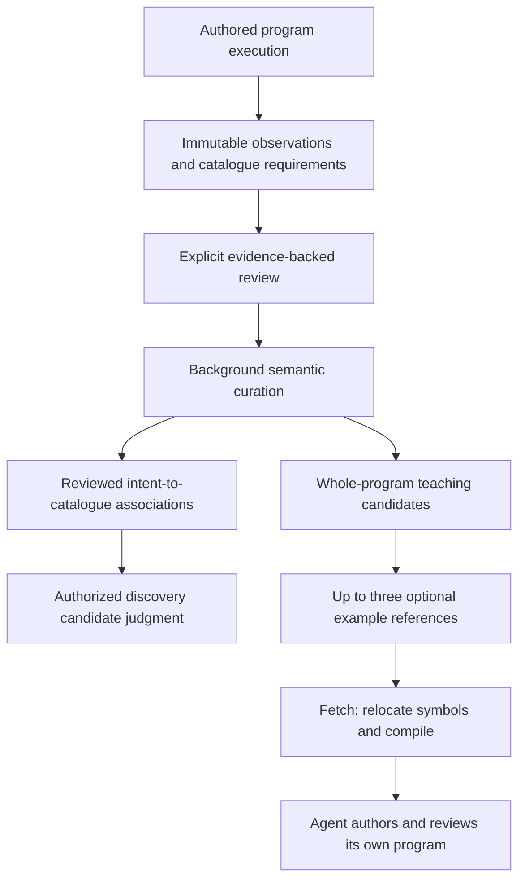

# Workflow teaching examples and catalogue guidance

Workflow learning is an optional OSS engine capability scoped to a tenant and
project. It retains successful **complete authored programs** as teaching examples
that another agent can inspect and adapt. A session may contain many programs;
a program may return many artifacts. Neither a graph branch nor an output
artifact becomes a separate example.

The LLM proposes an intent interpretation and semantic family. Deterministic
machinery owns execution evidence, authorization, catalogue compatibility,
publication limits, and compilation. Learning never executes provider operations
to test an example.

## Two independently useful results



**Catalogue guidance** associates a reviewed intent with the exact capabilities,
prerequisites, and contracts used by the observed program. It can improve normal
catalogue admission even when the program's source cannot be disclosed as an
example. Guidance remains subject to authorization, catalogue pins and the
existing discovery judgment; it never exposes a capability directly.

**Teaching examples** preserve authored literals, guards, branches, operation
order, and outputs. They carry qualified semantic references for rebinding
session symbols and the catalogue projection needed to understand and compile
the code. An ordinary literal does not need an authored reuse annotation to
appear in a teaching example. Recipient names and amounts may be neutral to
semantic intent matching while remaining distinct in the actual example source.
This does not establish behavioral equivalence between different literal values.

Formal reusable templates with typed arguments, generalized literal slots and
parameter relationships are future work. The current interface has no generated
`inputs` contract, synthetic demonstration defaults, automatic extraction,
consolidation, or alpha-renaming pass. An example is material for authoring, not
a parameterized executable recipe.

## Capture, review, and curation

The common operation runner owns learning evidence for HTTP, MCP and native
execution. It starts an attempt before effects and completes its evidence ticket
only after successful result/artifact persistence. Background HTTP completion
uses the same path. Failed or unresolved attempts cannot become successful
reviews. A learning-database failure does not change an otherwise valid business
result, but its authoritative session watermark remains incomplete. Failure to
persist the authoritative pre-execution checkpoint is a core execution failure.

`EvidenceJournal`, its pending adapter, and `ExecutionLearningTicket` own the
attempt lifecycle. `ReviewGate` owns the session lease and watermark fence;
`ReviewJournal` and `ReviewCommit` own a prepared invisible transaction and its
commit. The service finalizes the exact fenced watermark before the PostgreSQL
review and job become visible. Concurrent completions advance a contiguous
watermark; an older completion cannot close a different attempt's gap.

A receipt retains private original source, compiled computation, catalogue
fingerprints, execution artifacts, and two separate assessments:

* `ProgramObservation` records extracted teaching source and compiler-known
  disclosure information, or an explicit extraction/context diagnostic.
* `CatalogueRequirementEvidence` records compiler-derived capability closure and
  catalogue contracts, or an explicit unavailable diagnostic.

Static dependencies are issued as `CompiledCatalogueDependencies` by the compiler
and bound to the complete computation digest. Teaching and guidance consume that
single immutable evidence; learning does not reinterpret the execution DAG.
Compiler and runtime preflight share the static relation capability contract,
while runtime owns row-dependent dispatch. This static evidence precedes full
Python admission and proves neither execution success nor behavioral equivalence.

Those contracts include capability descriptions, typed input/output schemas,
referenced value domains, provided fields and invalidations. They give semantic
curation actual catalogue meaning even when source is withheld. Transport
mappings, authentication configuration and input defaults are excluded.

Observation capture is not publication. A later explicit `plasm_review` identifies
achieved outcomes and their successful runs. Goal satisfaction is agent-attested
with evidence unless a registered deterministic postcondition proves it. Missing
review, disconnects and timeouts never trigger promotion. Review retries are
idempotent; later activity cannot alter the sealed revision.

Multiple receipts from one program execution form one program observation for
quality assessment. The worker groups consistent whole-program evidence, obtains
bounded semantic interpretations through `ProposalModel`, and emits a
`CurationBatch` with separate examples and catalogue associations. Uncertain
family matches remain unpublished. Authoritative evidence cannot be issued or
upgraded by an LLM response.

Every normalization request owns a bounded response schema and allowed existing
family set. Its pending audit record is durable before provider dispatch; the
accepted, rejected or transport-failed response is retained afterward. Absent
usage is not reported as zero usage. The configured provider and scripted test
provider use the same protocol.

## Disclosure is separate from semantic portability

Compiler operand evidence identifies known sensitive input consumers from
existing catalogue metadata. Other classifications include actual controls,
validated domain constraints, known entity-reference inputs, and unclassified
operands. An unclassified operand is not a mandatory template-admission failure.
No `InputReuse` catalogue field is part of this design.

Known embedded sensitive operands and unresolved sensitive dataflow withhold the
complete source from model packets and example publication. A sensitive value
retrieved at runtime is distinguished from a secret embedded in source. The reviewed capability association
can still be curated using permitted outcome and requirement information.
`NoKnownSensitiveOperands` means the compiler found no classified sensitive
operand; it is **not a universal secret detector**. Unlabelled arbitrary text,
comments and review prose are not proven free of secrets by this assessment.
The private original receipt remains retained either way.

`CheckedTeachingExample` establishes the integrity of an admissible teaching
representation. It is not proof of successful execution across unseen inputs.
Known sensitive source is not rewritten into a fabricated successful example.
Broad rewrites cannot inherit execution success merely because they typecheck.

## Durable original symbol authority

Compilation captures the existing `PersistedSymbolLedger`, its catalogue pins,
source/computation digests, and compiler/wire versions. That immutable snapshot
travels through the compiled bundle, dry evaluation, persisted plan-commit cache,
and reconstructed native/MCP execution bundle. It is outside semantic plan
identity: adding provenance does not change commit or schedule hashes.

Compilation-context pins and exposed-ledger pins describe separate authorities.
A native host may compile with additional loaded catalogues that have no exposed
symbols, including the context assigned to ordinary Python compute. Exact
reconstruction retains that original compilation context, while the saved ledger
restores only its exposed graphs. Every pin must match its authoritative catalogue;
the teaching dependency projection still follows actual program requirements.

Nominal `v#` annotations belong to the prepared `PythonTeachingState`, not the
entity/relation ledger. The compiler captures that exact state separately.
Serving prepares named-domain declarations through the same renderer and checks
the domain's owning catalogue and semantic contract. A type-only catalogue can
be exposed without inventing entities or callable capabilities.

Each receipt attaches tenant/project, logical-session and execute-session
identity to that original snapshot. Logical sessions, run artifacts, compiled
programs, prompt hashes and execute sessions use distinct validated identity
types across durable evidence and review boundaries. Host repair validates ownership, digests,
versions and exact catalogue pins before hydrating the saved ledger. It uses a
fresh session core and graph cache, not live recorded outputs from another
session state, then runs production Python admission and checks the complete
computation. Repair does not create a successful receipt or publish a candidate.
Missing recorded prerequisites remain unavailable.

Historical receipts without captured context remain explicitly unavailable for
exact repair. Old parameterized-example artifacts are not reinterpreted as
teaching examples. Teaching witness version 2 also rejects earlier examples
without the separate nominal-symbol authority; retained incompatible revisions
are not eligible for approval, publication or serving.
Incompatible representation/compiler contracts require
revalidation through the current path; sealed evidence is never retroactively
filled using guessed symbol orders or edited defaults.

## Publication and bounded retrieval

The durable repository atomically publishes examples and catalogue guidance
under the review's publication policy. Shadow mode retains candidates only;
reviewed mode requires trusted host approval; serving mode may publish eligible
reviews automatically. Agent tools cannot approve publication. Frozen proposal
and guidance artifacts support reviewed publication without repeating a semantic
model call. Superseded and incompatible revisions remain stored.

Example portfolios are bounded to three active examples per semantic family and
catalogue variant, with a configurable tenant-wide default cap of 1,000 across
projects. Duplicate observations add evidence rather than new copies. Tenant
serialization and family revision checks protect concurrent publication. Guidance
has its own bounded active storage; it does not depend on an example remaining
serveable.

Quality separates assurance, observed robustness, call cost, teaching cost and
readability. `Unassessed`, `ObservedSuccess` and `InsufficientEvidence` are distinct;
symbol validity does not manufacture behavioral robustness guarantees. Quality
references exact receipt digests belonging to the candidate's whole program.
A successful program elsewhere in the same review cannot lend it evidence.
Comparison abstains when required assessments are unavailable. Lower cost cannot
silently replace a different behavioral contract, such as code with a removed
guard.

Recall combines normalized intent with catalogue-qualified evidence. Existing
lexical/vector retrieval generates candidates; it does not prove interchangeability.
Authorization and scope filtering precede disclosed metadata. Catalogue guidance
checks prerequisite capability authorization and current fingerprints. Embedding
profile identity prevents mixing vector spaces. PostgreSQL JSON-vector cosine
uses a scoped exact scan, not an approximate-nearest-neighbor extension.

## Discovery and optional fetch

`plasm_context` incorporates authorized guidance into normal discovery candidate
judgment and may offer up to three example summaries. Fetch remains optional.
`plasm_example` accepts `logical_session_ref` and `example_ref`; it resolves the
authoritative dependency closure, prepares exposure in a staged session, binds
semantic references to the actual ledger, and compiles the **complete** teaching
source through normal Python admission. It returns source, output contracts,
catalogue fingerprints and the required teaching delta. It does not execute code
or return generated template parameters.

Fields and literal values remain authored. Only compiler-resolved session symbol
occurrences are relocated; strings and comments resembling symbols are untouched.
Successful compilation is required on every fetch. Referenced semantic contract
drift or invalid code retains diagnostics and excludes the revision from serving.
Permission denial and missing connections are request ineligibility, while
infrastructure failures remain unverified rather than declaring global corruption.

Exposure publication checks the session revision and example compatibility under
lock. Redis commits descriptor, ledger and fetch receipt atomically; local
sessions use their authoritative aggregate. Failed checks leave no partial
exposure. Fetch requires a resident session and does not implicitly acquire
missing business data or dynamic schema. Examples confer no execution authority:
ordinary plan review and execution remain mandatory.

## Configuration and validation

`PLASM_WORKFLOW_DATABASE_URL` selects the PostgreSQL learning ledger.
`PLASM_WORKFLOW_LEARNING` selects `shadow`, `reviewed`, or `serving`; omission
disables learning. `PLASM_WORKFLOW_LEARNING_TENANT_CAP` sets the active example
cap. `OPENROUTER_API_KEY` supplies the existing background model/embedding client;
without it fresh model work is not dispatched. `PLASM_WORKFLOW_MODEL` optionally
overrides the independent normalization chat model. Evaluation must keep held-out
sessions outside collection and freeze publication, catalogue and model settings.

Offline contract fixtures run with:

```sh
python3 -m unittest discover -s scripts/workflow_learning
```

These dependency-free models test evidence fencing, tenant/project isolation,
bounded portfolios, exact-source symbol relocation, separate guidance/disclosure,
and atomic fetch failure behavior. They do not emulate the production compiler
or establish usefulness. Rust `workflow_learning`, native process restart,
recorded symbol-context, session coherence and compiler tests provide the actual
implementation checks. PostgreSQL, Redis and Monty integrations require their
explicit local fixtures. Validation results belong to the run artifacts; old
parameterization-era counts are not evidence for this architecture. No live
provider experiments or improved task-success claims follow from offline tests.
